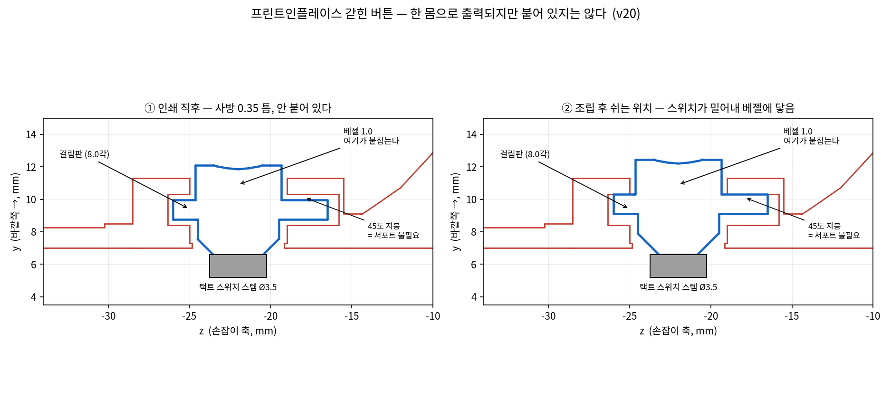

# CROWN MINI CHEER STICK — v20

**버튼이 손잡이 안에 갇힌 채로 출력됩니다.** 그리고 택트 스위치 실물 데이터시트를 반영했습니다.
전장 130.2mm · 헤드 Ø47 · 손잡이 Ø17

```bash
python3 crown_v20.py     # STL 생성
python3 verify20.py      # 자동 검증
python3 plate20.py       # 출력 방향 정렬
```

---

## 1. 갇힌 버튼 (프린트인플레이스)

말씀하신 대로 됩니다. **버튼은 이제 별도 부품이 아니라 손잡이 STL 안에 들어있습니다.**
같은 파일 안의 **떠 있는 두 번째 덩어리**로 출력되고, 사방 0.35mm 틈이라 붙어 있지 않습니다.



```
   베젤 1.0  (구멍 Ø6.0)  ← 이 1mm 가 걸림판을 붙잡는다
      ↓
   걸림판 8.0각  ← 구멍(6.0)보다 2.0 크다. 물리적으로 빠질 방법이 없다
      ↓
   플런저 Ø5.0, 끝은 45도 원뿔
      ↓
   택트 스위치 스템 Ø3.5  ← 되돌리는 힘은 스위치가 낸다
```

**핵심은 되돌리는 힘을 스위치한테 맡긴 것입니다.** 얇은 플렉셔도, 스프링도 없습니다 —
v18 후크처럼 부러질 부분이 하나도 없습니다.

| | v19 | v20 |
|---|---|---|
| 부품 수 | 버튼 별도 (9종) | **손잡이에 포함 (8종)** |
| 조립 | 눌러 끼워야 함 | **없음** |
| 잃어버릴 수 있나 | 예 | **아니오** |
| 빠질 수 있나 | 스템 물림에 의존 | **구멍보다 커서 불가** |

### 조립할 때 무슨 일이 일어나나

인쇄 직후 플런저 끝은 스템 자리보다 0.35mm 안쪽에 떠 있습니다.
캐리어를 위에서 밀어 넣으면 **스위치 스템이 45도 원뿔을 타고 버튼을 0.35mm 밀어냅니다.**
그 뒤로는 걸림판이 베젤에 눌려 붙어 덜그럭거리지 않습니다.

캐리어 +y 면에 **0.85mm 채널**을 팠습니다 — 플런저 끝이 지나갈 길입니다.

### ★ 11_btntest_RED 를 먼저 뽑으세요

19 × 9 × 18mm, **2분**. 손잡이의 버튼 부분만 그대로 떼어낸 것이고 **출력 방향도 같습니다.**

- 눌러서 딸깍 움직이면 → 전 파트 출력 진행
- 안 움직이면 (융착) → `BTN_GAP` 을 **0.40** 으로 올리고 다시 생성
- 덜그럭거리면 → `BTN_GAP` 을 **0.30** 으로

62mm 짜리 손잡이를 뽑아놓고 버튼이 안 움직이면 통째로 폐기입니다. 2분 투자하세요.

---

## 2. 택트 스위치 — 보내주신 데이터시트 반영

**`SW_LEGS` 를 6.5 로 알고 있었는데 실제는 7.9 였습니다. 다리가 휘던 진짜 이유가 이겁니다.**

| 값 | v19 (가정) | v20 (데이터시트) | 파라미터 |
|---|---|---|---|
| 몸통 | 6.0 × 6.0 | 6.0 × 6.0 ✔ | `SW_W` |
| 몸통 높이 | 3.7 | **3.6** | `SW_DEEP` |
| 스템 지름 | 3.5 | 3.5 ✔ | `SW_STEM_D` |
| 스템 높이 | 1.2 | **1.4** (= L 5.0 − 몸통 3.6) | `SW_STEM_H` |
| **다리 span (넓은 축)** | 6.5 | **7.9** (자유 상태) | `SW_LEGS` |
| 다리 span (좁은 축) | — | **5.4** (구멍피치 4.5 + 다리 0.7) | `SW_LEGX` |
| 행정 | 0.4 가정 | **0.25** ±0.1 | `SW_TRAVEL` |
| 조작력 | — | 130 / 160 / **250** gf | `SW_FORCE` |
| 수명 | — | 100,000 회 | — |

**7.9 는 PCB에 꽂기 전 자유 상태 값입니다.** 구멍(6.5)에 꽂으면 오므라들죠.
우리 캐리어에는 PCB가 없으니 오므릴 이유가 없습니다 → **7.9 기준으로 팠습니다.**
그리고 넓은 축(7.9)을 **위아래(z)로 눕혔습니다** — 손잡이 지름이 좁은 건 좌우(x)니까요.

스템이 1.4로 높아져서 스위치를 **0.55mm 더 깊이** 앉혔습니다
(`SWF_Y` 5.75 → **5.20`**). 스템 끝 y6.60 < 구멍벽 7.0 ✔

**살 때** : `택트스위치 6x6x5 4핀 DIP`. 뒤 숫자 5.0 인 것만.
조작력은 **160gf(1.6N)** 이 무난합니다. 250gf 는 응원봉으로 쓰기엔 좀 뻑뻑합니다.

---

## 파트 (8종) — 버튼이 손잡이로 들어가 하나 줄었습니다

| 파일 | 크기 (출력 방향) | 부피 | 비고 |
|---|---|---|---|
| `11_btntest_RED` | 19.0×9.0×18.0 | 1.4 | **★★ 이것부터 (2분)** |
| `10_fitgauge_RED` | 74.0×34.0×9.6 | 6.0 | ★ 공차 확인 |
| `01_dome_WHITE` | 37.7×37.7×32.4 | 4.9 | 벽3겹 인필0% |
| `02_crown_RED` | 47.7×49.7×37.4 | 16.5 | 벽4겹 + 브림 5mm |
| `03_base_RED` | 34.8×34.8×8.1 | 3.3 | 플랜지가 바닥 |
| `05_handle_RED` | 39.0×39.0×62.1 | 9.6 | **★ 2덩어리가 정상** |
| `07_carrier_RED` | 13.7×13.3×46.1 | 2.6 | 벽4겹 |
| `08_finial_RED` | 9.6×9.6×13.9 | 0.5 | 뒤집지 말 것 |
| `09_cross_RED` | 13.0×19.5×3.6 | 0.5 | **반드시 눕혀서** |

합계 **39.3 cm³ ≒ 49 g**.

### ⚠ 슬라이서에서 손잡이가 "2 objects" 로 보입니다 — 정상입니다

**절대 "merge" 하거나 "union" 하지 마세요.** 붙이면 버튼이 죽습니다.
`05_handle_RED` 는 손잡이 + 갇힌 버튼 = 2덩어리가 맞습니다.

버튼 주변만 **인필 100%** 로 올리면 더 좋습니다 (얇은 걸림판 1.2mm 라서).

---

## 검증

```
── 덩어리 수 ──
   05_handle_RED      2  OK  ← 버튼이 안 붙어 있다는 뜻 (정상)
── ★ 갇힌 버튼 (프린트인플레이스) ──
   버튼 부피                      :  156.63 mm3
   버튼↔손잡이 최소 인쇄틈        :    0.350 mm
   밖으로 빼려 하면 (0.35→1.5)    : [0.0, 7.9, 14.25, 26.95, 31.71]  ← 못 빠진다
   안으로 누르면 (0.35→1.1)       : [0.0, 4.76, 11.11, 23.81]        ← 0.35 누르고 바닥
   쉬는 위치에서 스템에 닿나      :    0.000 mm3  (딱 닿음)
   0.25mm 눌러 스템을 밀는 양     :    1.38 mm3   (>0 = 클릭)
── 캐리어 하강 스윕 ──
   +0 / 2 / 5 / 10 / 20 / 30 / 40mm : 전 구간 0.00
```

기존 항목(클램프·손잡이 베이어닛·돔 베이어닛·보드 고정·플러그 도달)도 전부 유지.

### 이번에 또 걸린 옛날 실수

버튼을 손잡이 가공 **중간**에 붙였더니 뒤의 보어 재관통이 플런저 끝을 0.53mm 잘라먹었습니다.
v13 손잡이 바닥, v14 스트랩 귀와 **똑같은 "자른 뒤에 붙였다" 패턴**입니다 (이번엔 반대 방향).
버튼 본체는 이제 손잡이 가공이 전부 끝난 맨 마지막에 얹습니다.

---

## 남은 것
- 펌웨어 (IMU 흔들림 → CDC 시리얼, 버튼, LED, 밝기 상한)
- 크롬 확장프로그램 (Web Serial → 치지직 채팅 입력)
- USB-C 브레이크아웃 실측 (`SK_*` 6개)
